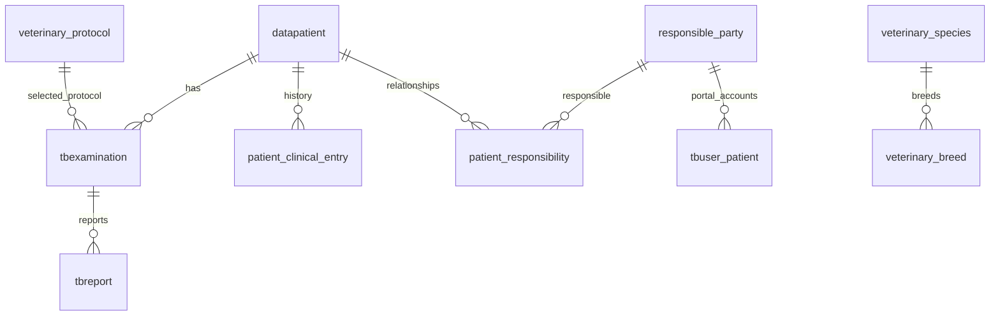

# NextRIS veterinary edition

## Architecture and installation mode

This edition extends Flask, PostgreSQL/psycopg2, the existing JWT API, and the existing patient,
appointment, examination and report tables. It does not create an animal-specific copy of the RIS.
`apps/services/veterinary.py` owns validation, identity, longitudinal history, responsibility and
clinical snapshots. `veterinary_hooks.py` connects it to existing resources only when veterinary
mode is enabled. Human installations retain their existing handlers and validation.

```dotenv
NEXTRIS_PATIENT_MODE=veterinary
NEXTRIS_PATIENT_ID_ISSUER=CDIVET
NEXTRIS_MWL_ENABLED=false
NEXTRIS_DISABLED_MODULES=nexi,structured_reports
```

The default patient mode is `human`. Invalid modes fail startup. Veterinary startup requires the
explicit migration below. Public `GET /api/app-config` includes `patient_mode` and `mwl_enabled`;
no secret is exposed. Both repositories use branch `version/veterinaria`, based on backend `main`
and frontend `ui2`. Existing deployment fixes disabling Nexi and structured reports are retained.

## Data model



- `datapatient.patient_kind` distinguishes `human` and `animal`. Existing `patient_type` is unchanged.
  Existing patients become/remain human; no historical patient is automatically reclassified.
- Animal UUIDs and sequence-generated `VT…` PatientIDs do not depend on owners. A partial unique
  index protects animal PatientIDs. Changing an owner never rewrites identity, studies or images.
- Species and breeds are editable catalogs. Canine and feline descriptions are seeded without
  fabricated terminology codes. A breed must belong to its selected species.
- Animal names are required; surname and owner identity documents are not animal identifiers.
  Unknown birth dates remain null. Estimated dates are explicitly marked; future dates are rejected.
- Reproductive status is `unknown`, `intact`, or `neutered`. Sex retains the existing `M/F/O` codes.
- Clinical entries are appended with author and dates. Categories are history, alert, weight and
  correction; corrections reference an entry of the same animal. There is no destructive edit API.
  Weight is recorded in kg, positive, finite, and with up to three decimal places. The latest dated
  measurement is the current weight. Zero is permitted only as a protocol's lower bound.
- Responsibilities have a role, beginning/end, main-responsible flag and explicit portal grant.
  Multiple active responsible parties are allowed; only one active relationship can be primary.
- `tbuser_patient` references either a human patient or a responsible party, enforced by an XOR
  constraint. Existing human accounts are preserved. Responsible accounts can represent several animals.
- Protocols reference existing study, modality and anatomical-region catalogs. Weight limits,
  preparation and checklist are institution-defined; there are no automatic sedation/dose recommendations.
- Orders and appointments store the protocol and demographic/preparation snapshot selected when
  created. Signed reports freeze the current animal/responsible context and retain the selected
  protocol snapshot. Later master-data or owner changes do not alter that signed veterinary context.
- Templates reuse `tbinfpredef`: human/animal/any scope, optional species, existing study type for
  modality/body region, and the normal simple report sections. The structured-report engine remains off.
  `/api/templates` stores and filters by `species_id` in veterinary mode. `animal_fields` and
  `fill_animal_fields` replace `{{Campo}}` tokens when a report opens or is saved; a missing datum becomes `[[ ]]`.

## HTTP interfaces

Responses retain `{success, data, message}`. Existing patient CRUD and quick registration routes
accept veterinary data in veterinary mode, for example:

```json
{
  "name": "Animal de ejemplo",
  "patient_kind": "animal",
  "gender": "F",
  "birthdate": "2022-01-01",
  "veterinary": {
    "species_id": "a0000000-0000-4000-8000-000000000001",
    "breed_id": null,
    "birthdate_estimated": true,
    "reproductive_status": "neutered",
    "weight_kg": 12.5
  }
}
```

Unknown species and an absent responsible party are allowed for provisional registration. Resolve
the species before DICOM metadata generation. Animal IDs cannot be edited. Animal deletion/merge
and animal-specific shared portal credentials are not exposed. Use dated relationships for ownership.

| Resource, under `/api/veterinary` | Methods | Purpose |
|---|---|---|
| `/species`, `/breeds` | GET, POST | Read/create catalogs |
| `/species/:id`, `/breeds/:id` | PUT | Edit names and optional terminology coding |
| `/responsibles`, `/responsibles/:id` | GET/POST, PUT | Responsible party and contact management |
| `/responsibles/:id/account` | POST | Issue a random initial credential, returned once |
| `/responsibles/:id/accounts` | GET | List that party's account identities, never password hashes |
| `/responsibles/:id/accounts/:account/reset-password` | POST | Recovery; invalidate prior account sessions and image grants |
| `/patients/:id/responsibles` | GET, POST | Read history/add a relationship; portal grant defaults false |
| `/relationships/:id/end` | POST | End a relationship and revoke its access without deleting history |
| `/patients/:id/history` | GET, POST | Longitudinal clinical entries/weight |
| `/protocols`, `/protocols/:id` | GET/POST, PUT | Acquisition and preparation configuration |
| `/templates`, `/templates/:id` | GET/POST, PUT | Existing simple templates with veterinary applicability |
| `/patients/:id/orders` | GET, POST | Existing examination/report tables and optional appointment |
| `/portal/profile` | GET, PUT | Responsible's own identity and contact details |
| `/portal/animals` | GET | Animals currently authorized for this account |
| `/portal/animals/:id/studies` | GET | Animal's visible, non-cancelled studies |
| `/portal/reports/:exam`, `/portal/reports/:exam/pdf` | GET | Authorized finalized report and PDF |
| `/portal/images/:exam` | POST | A 15-minute study-scoped viewer link |

Order creation accepts `study_type_id`, optional `protocol_id`, `clinical_question`, `history`,
`requesting_veterinarian`, and optional ISO `scheduled_start`/`scheduled_end`. Equipment is optional
and no worklist transmission occurs. Existing `POST /api/worklist` is adapted to the same service
for veterinary mode. External incoming orders must identify an existing animal by its internal
PatientID/UUID; the owner's DNI is never a patient-matching key.

## Authorization and portal

Existing saved clinical permissions are retained. New staff permissions are
`veterinary.responsibles.manage`, `veterinary.portal.manage`, `veterinary.history.manage`,
`veterinary.protocols.manage`, and `veterinary.catalogs.manage`. The veterinary catalog is excluded
from human-mode permission seeding. Existing `patients.view/manage`, `templates.manage`,
`admissions.create_spontaneous` and `dicom.studies.manage` protect their respective operations.

Responsible JWTs keep `user_type=patient` and add `portal_subject=responsible` and an account
authentication version. The API checks the account from the database and denies staff APIs by
default, regardless of client-side menu changes. Initial password change is required before clinical
portal access. Owner email validation and password hashing reuse the existing account services.

A currently authorized responsible sees all publicable historical studies of the animal, including
those before the relationship began. Closing a relationship removes access immediately, including
existing access/refresh sessions and links for that animal; other animals remain accessible.
An account password reset invalidates all old account sessions and its issued image links.
Animal visibility is rechecked for each report/PDF and each DICOM proxy request. Hidden, draft,
empty and cancelled reports keep the existing clinical publication restrictions.

The owner viewer never receives a general technical PACS token. It uses the existing single-study
RIS gateway with a short-lived grant bound to the account and animal. Upstream technical
credentials remain server-side. Responsible identity is not substituted into DICOM PatientName.

## Manual DICOM and MWL

`POST /api/manual/upload` continues to use the existing STOW, registration and linking pipeline.
Veterinary mode additionally requires multipart `patient_id` and `exam_id`. A mismatch in identity,
accession, name/species/breed requires `confirm_identity=true` explicitly. An already-associated
study cannot be assigned to a different animal by uploading it again.

The source file and a SHA-256/actor/patient/exam provenance record are retained privately in
`uploads_dicom/originals`. The upload copy uses the selected animal PatientID/name and order accession;
coercion is described in DICOM Original Attributes Sequence. Source study/SOP UIDs and existing
study-specific weight/neutering information are preserved. Missing veterinary attributes can be filled
from the selected animal. Catalog codes are optional, paired with coding scheme, and format-validated;
the institution is responsible for the terminology it configures.

The serializer supports species/breed descriptions and configured code sequences, responsible
person/role/organization, sex-neutered state and weight. Sources:
[DICOM Patient Module](https://dicom.nema.org/medical/dicom/current/output/chtml/part03/sect_C.7.html),
[Patient Study Module](https://dicom.nema.org/medical/dicom/current/output/chtml/part03/sect_C.7.2.2.html).

The separate adapter can use DCM4CHEE's native `POST /aets/{aet}/rs/mwlitems` with DICOM JSON.
It refuses sending when `NEXTRIS_MWL_ENABLED` is false, before making any HTTP request. This
release does not configure equipment, precalculate institutional acquisition protocols, enable MWL,
change the human HL7 profile, or certify a physical modality. Equipment configuration and conformance
validation are a later explicit deployment step.

## Migrations, deployment and recovery

1. Back up the live database, current code, private environment and service configuration; verify restore
   against a disposable database. Do not run the clinical HTTP tests on the live installation.
2. Initialize/update the general edition if needed, then run the explicit veterinary migration:

```bash
python deployment/migrate_veterinary.py
python deployment/migrate_veterinary.py --apply
```

The migration uses a PostgreSQL advisory lock and records its version. Schema changes and version
recording are atomic. Repeating an applied migration does nothing. To reverse an unused migration:

```bash
python deployment/migrate_veterinary.py --down --apply
```

The down migration refuses to discard animals, responsible accounts/parties, custom catalogs,
protocols, templates or clinical snapshots. Once veterinary data exists, roll back application code
while retaining the additive schema, or perform a separate verified data export/recovery operation.

3. Seed the existing permission catalog with the new code/environment, build the frontend and deploy
   the backend/frontend pair. Keep JWT secrets unchanged to preserve staff sessions.
4. Set veterinary mode, keep MWL/Nexi/SR disabled, and restart the backend. Verify health, current
   module visibility, manual order creation and portal authorization without creating clinical test
   patients on production.
5. Use isolated synthetic data for regression. Configure the institution's study types, species/razes,
   preparation protocols and responsible permissions through the normal administration UI.

## Automated validation

The API suite uses real HTTP requests and PostgreSQL, no mocked database. It refuses databases
whose names do not end in `_test` and requires explicit opt-in. Run a separate test server from the
test checkout on port 5003 using its private test `.env`:

```bash
NEXTRIS_VETERINARY_TESTS=1 python tests/test_veterinary_api.py
NEXTRIS_PATIENT_MODE=human NEXTRIS_GENERAL_TESTS=1 python -m unittest discover -s tests -p test_general_edition.py
```

Use separate disposable databases for parallel human/veterinary suites. Migration reversal is tested
first on an unused schema and then rejected once data exists. Coverage includes concurrent IDs,
validation, ownership transfer, multiple animals, stale sessions, password recovery, public-link
revocation, signed snapshots/PDF, protocol selection, appointment creation, saved permissions,
DICOM reconciliation/metadata preservation, and disabled external MWL.

Browser fixtures and tests:

```bash
NEXTRIS_VETERINARY_TESTS=1 VETERINARY_BROWSER_FIXTURES=/tmp/veterinary-fixtures.json python tests/prepare_veterinary_browser.py
```

The frontend's `test:veterinary:browser` consumes that private synthetic fixture file and only permits
a localhost target. It exercises actual staff/owner login, registration, ordering, writing, password
change, report access and profile navigation. Never publish fixture credentials or database dumps.

## Directory filtering

`GET /api/patients` in veterinary mode accepts `page`, `per_page`, `search`, `species_id`,
`breed_id`, `gender`, `responsible_status=linked|pending`, `sort_column`, `sort_direction`, and
`filter_<column>` for supported table columns. The response remains the existing paginated data
object. These filters apply before pagination; owner search uses the current relationship.

`GET /api/veterinary/responsibles?paginated=true` returns the same pagination envelope and
accepts search (name/document/email/phone), `kind`, `is_active`, supported column filters and
sorting. Without `paginated=true`, the original list contract used by relationship selectors remains
unchanged. SQL filter values are parameterized and sortable/filterable identifiers are allowlisted.
No schema migration or permission changes are required for this directory update.

Veterinary `GET /api/examinations/for-reporting` includes `responsible_name`, aggregating current
animal relationships (primary first). Global search matches responsible names; column filters
`responsible_name` and `responsible_query` and sorting by `responsible_name` operate in SQL
before pagination. Human mode does not query veterinary relationships or expose this field.

## Cargar Estudio (carpeta o ZIP)

`/api/veterinary/uploads` receives files by blocks into private storage (`NEXTRIS_UPLOAD_ROOT`, which must
live outside release directories). `cdivet-upload-worker.service` runs a single persistent worker: it detects
DICOM by content, accepts one `StudyInstanceUID` per upload and sends nothing to PACS until the operator picks
an animal and either an existing order or report generation. Order, draft report and link are committed together
after every instance and one frame are confirmed readable in PACS. A failed transfer stays `retryable` and only
resends missing instances; the selection cannot change once a transfer began. Originals are kept (`*.original`).
There is no size limit per upload: it is bounded by `NEXTRIS_UPLOAD_MAX_FILES` and by free disk space (HTTP 507).

Migration: `python deployment/migrate_veterinary_uploads.py --apply` (requires the veterinary base migration).
Tests: `NEXTRIS_VETERINARY_TESTS=1 python tests/test_veterinary_uploads.py`, on a `*_test` database with the API
on `VETERINARY_TEST_URL`. They use an in-memory PACS, so behaviour against a real archive needs a separate check.
